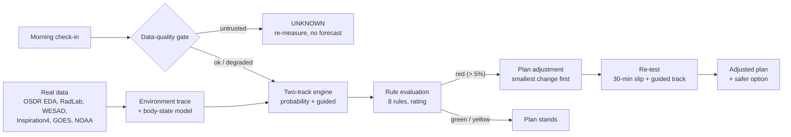

# SpaceFuzz

**Demo video (30 s):** [YouTube](https://www.youtube.com/watch?v=YZOfrG-3IPI)

"An ounce of prevention is worth a pound of cure." — Benjamin Franklin
An old Chinese saying goes further: the best doctor treats the illness before it appears.
SpaceFuzz brings this idea to space missions: instead of showing what a crew member's vitals are right now, it stress-tests the day's plan before it starts, finds where the body is likely to break first, and adjusts the plan before anything goes wrong. See the risk before it hits.

NASA Space Apps Challenge 2026 · Team Raccoon · Challenge: *Create Health Monitoring Software for Astronauts on Space Missions*

---

## What it does

Every morning, SpaceFuzz takes the crew member's check-in (sleep, blood pressure, glucose, mood, stress, fatigue and an optional reaction test) and the day's task plan, and fuzzes the day the way security engineers fuzz software: thousands of simulated what-if days built from real NASA data (ISS cabin air, Mars-surface radiation), each checked against eight deterministic health rules. The share of days that break a rule is the day's risk. If it is too high, SpaceFuzz searches for the smallest change to the plan that brings it down, re-tests the new plan, and tells the crew which single measurement to confirm first. A midday check re-forecasts the rest of the day.

In the main scenario (a Mars base, a 6.5 h EVA after a short night, a 3-night sleep debt of 6.9 h), the plan carries a **21.0% risk (HIGH)**, mostly from sleep debt; **15 minutes less sleep** would push it to 100%. Shortening the EVA by 2 h, adding a 1 h nap and splitting the EVA brings it to **4.9% (MEDIUM)** without touching tonight's sleep. Postponing the EVA would be **0.1%** for today.

## Quick start

```bash
python3.11 -m venv .venv && .venv/bin/pip install -r requirements.txt
.venv/bin/streamlit run app.py
```

Tested on Python 3.11 and 3.12; other recent versions are likely to work.

Open http://localhost:8501 and press **Run Forecast**. The demo results are read from the committed cache, so the forecast appears in a few seconds (about 10 seconds on the very first run after installing, while Python compiles and loads the libraries) and the app runs with the network off.

## Running notes

- **Precomputed results.** The demo results (fixed seed 147, full sampling profile) are stored in `cache/`, so a fresh clone shows them offline in seconds. Editing a check-in value (including taking the reaction test) or entering a midday sleep value other than the example triggers a live computation with the lighter local profile, which takes a few minutes.
- **No download needed to re-run the engine.** Without the WESAD data, the engine generates the real heart-rate fluctuation from fitted parameters (`data/processed/wesad_params.json`), so re-computed numbers can differ slightly from the committed ones. To reproduce them exactly, download WESAD (links in `data/SOURCES.md`) and run `python -m spacefuzz.readers.physio_replay --build`.
- **Data in the repository.** The WESAD raw data (3.8 GB) is not committed: its licence allows academic, non-commercial use only and no redistribution. The other raw data is public domain or NASA open data; only the two files the app reads (EDA RR-1 cabin telemetry and MSL-RAD Mars-surface dose rate) are committed, the rest is listed with links in `data/SOURCES.md`.
- **Optional AI hint (off by default).** When the data-quality gate rejects a check-in, and only if you put your own `OPENAI_API_KEY` in a `.env` file, the check-in page shows an "Ask AI what went wrong (optional)" button. It sends only the rejected fields, the values entered and their plausible ranges, and shows a short plain-language explanation. It never changes a decision or a number; without a key the app runs exactly as before. It was not used in the demo or the recordings.
- **Safety checks are deterministic rules, not an LLM, so every decision is reproducible and runs offline.**

## Demo entry points

| URL | What it shows |
| --- | --- |
| `/?scenario=main_sleep_debt_eva` | Main scenario: sleep debt + EVA (Mars base) |
| `/?scenario=radiation_spe` | Solar particle event warning 09:00–15:00 with an EVA planned at 10:00 |
| `/?scenario=backup_high_co2` | Backup CO2 scrubber, docking after long cabin work: stays red, reported to the ground |
| `/?view=crew&autoplay=1` | Crew screen: in-mission visor (HUD) and the adjusted plan |
| `/?view=surgeon&autoplay=1` | Flight surgeon screen: risk, act-now advice, before/after |
| `/?view=engine&autoplay=1` | Engine screen: fuzz log, crash-boundary map, trajectory fan |

Scenario and view combine, for example `/?scenario=radiation_spe&view=crew&autoplay=1`. `autoplay=1` plays the forecast once without a click (multi-screen demos). The menu also opens the morning check-in, the midday check, the NASA Data page and the indicator wiki. The HUD shows the forecast median for the first EVA of the adjusted plan, not live telemetry.

## How it works



- **Real data → environment curves.** ISS cabin CO2, temperature and humidity (NASA OSDR EDA, RR-1, used as the Mars-base analog) and Mars-surface dose rate (NASA RadLab, MSL-RAD) are cut to "minutes since start" and resampled to 15-minute steps, so 2014 cabin air and 2017 radiation share one simulated day.
- **Body-state model and four causal chains.** A 96-step day (15-minute steps) models heart rate, HRV, core temperature, SpO2, blood pressure, glucose, cognitive fatigue, reaction time and radiation load. Four causal chains drive it: acute stress (WESAD fit: +21.7 bpm, RMSSD ×0.512), energy and heat (EVA heat storage, cabin CO2), sleep debt, and glucose.
- **Six mutation operators.** Solar particle events (radiation), sleep debt (isolation and confinement) and cabin CO2 excursions (hostile, closed environment) map onto NASA's spaceflight hazards; EVA load and multitasking model workload; sensor faults test the system itself.
- **Two-track engine.** The probability track draws 2,500 unbiased days, each operator switched on with its real daily probability, and is the only source of the risk number. The guided track (10,000 rounds) searches for crash types; a deterministic scan and a crash-boundary map show the smallest change that turns the plan red.
- **Eight rules with sourced thresholds.** Four composite rules (cardiovascular, cognitive, metabolic, radiation dose) and four temporal rules (short sleep → EVA, training → EVA, high CO2 → precision work, solar particle warning → EVA). Thresholds are traced to NASA-STD-3001, NASA HRP risk pages, Jones et al. (*Sleep* 2022), ADA and AHA/ACC guidelines; all are illustrative.
- **Smallest change first, then re-test.** Candidate fixes (move, shorten or split the EVA, add rest or a nap, move training, postpone) are tried in order of size and never move or shorten planned sleep. A plan reported as fixed must survive a 30-minute schedule slip and a guided-track re-test. When nothing gets the plan out of red, the lowest-risk fallback gets the guided-track re-test only and is reported to the ground; the slip check asks whether a fixed plan keeps a margin, and a red plan has none.
- **Bad data is never forecast.** A data-quality gate checks every input (ranges, stuck values, missing fields); a rejected check-in gives UNKNOWN and names what to re-measure.

Full details, every threshold and its source: **[TECHNICAL.md](TECHNICAL.md)**.

## Demo results

Seed 147, full sampling profile (cached in `cache/`).

| Scenario | Before | After | Adjustment |
| --- | --- | --- | --- |
| Main: sleep debt + EVA | 21.0% HIGH | **4.9% MEDIUM** | EVA shortened by 2 h, a 1 h nap at 10:00, EVA split into 11:00–13:15 and 14:15–16:30 |
| Main, safer option | 21.0% HIGH | **0.1% LOW** (today only) | Postpone the EVA; it is forecast again at the next morning's check-in |
| Radiation: solar particle event warning | 100% | **3.0% MEDIUM** | 30-min rest, EVA starts at 15:30. Starting right at 15:00, when the warning ends, failed the re-test: a 15-minute slip lands it inside the warning |
| Backup: high CO2 + docking | 100% | **32.3% HIGH** | Still red: reported to the ground flight surgeon |
| Midday check (14:00, wristband sleep 5.9 h) | Afternoon 100% CRITICAL | **4.9% MEDIUM** | Afternoon EVA moved to 18:00 (12 h after waking), personal time cancelled; tonight's sleep stays at 23:00, 6 h |

**Measure first.** On the main plan, last night's sleep (6.2 h) is 0.2 h above the 6-hour line; within its measurement error (±0.5 h) the risk moves by 79 percentage points, so the first prompt is to confirm last night's sleep with the wristband.

**Validity.** Across 5 seeds (2,500 samples each), the main scenario stays between 19.4% and 21.2% (red every time) and a well-rested control day between 0.7% and 1.2% (never red). Moving each of the 12 rule thresholds to 0.8–1.2× one at a time keeps the risk ranking of the five example plans stable (Kendall τ ≥ 0.8) in 92% of 48 cases, and the adjustment lowers the main plan's risk in 94% of them and never raises it (median drop 16.2 percentage points).

## Data sources

Full file names, processing notes and licences: [`data/SOURCES.md`](data/SOURCES.md).

| Dataset | Used for | What it supports |
| --- | --- | --- |
| [NASA OSDR EDA, RR-1 ISS cabin telemetry](https://visualization.osdr.nasa.gov/eda/) | Cabin CO2, temperature and humidity curves | Operator B and rule 3; the high-CO2 line of 3,997 ppm (90th percentile of 15-minute cabin CO2) |
| [NASA RadLab: MSL-RAD, Mars surface](https://visualization.osdr.nasa.gov/radlab/gui/data-overview/) | Dose rate and the September 2017 solar particle event shape | Operator D and rule 4; event peak 2.98× baseline, 47 h |
| [NASA RadLab: DLR DosTel2, ISS](https://visualization.osdr.nasa.gov/radlab/gui/data-overview/) (partner-agency instrument) | ISS dose rate | Dose cross-check: time-weighted mean 8.8 µGy/h |
| NASA OSDR Inspiration4 clinical panels: [OSD-569 (CBC)](https://osdr.nasa.gov/bio/repo/data/studies/OSD-569), [OSD-575 (CMP)](https://osdr.nasa.gov/bio/repo/data/studies/OSD-575) | Clinical baseline ranges | Bounds of the synthetic baseline for glucose and hemoglobin |
| NASA HRP: [5 Hazards of Human Spaceflight](https://www.nasa.gov/hrp/hazards/), [Risks of Human Spaceflight](https://www.nasa.gov/hrp/risks/) | Risk framework and indicator sources | The scenarios cover four of the five hazards; each of the 14 indicators is linked to an official risk page |
| CSA: [Why Do We Conduct Science Experiments in Space?](https://www.asc-csa.gc.ca/eng/iss/science/why-do-we-conduct-science-experiments-in-space.asp), [Monitoring Radiation for Astronaut Health](https://www.asc-csa.gc.ca/eng/news/articles/2026/2026-02-26-monitoring-radiation-astronaut-health.asp) (partner agency) | Deep-space mission risks; ISS radiation monitoring | Deep-space crews cannot rely on emergency medical support from Earth; neutrons are about 30% of total ISS radiation |
| [NOAA GOES-16 XRS](https://data.ngdc.noaa.gov/platforms/solar-space-observing-satellites/goes/goes16/l2/data/xrsf-l2-avg1m_science/2017/09/) (non-NASA, supplementary) | Flare timing | About 12.9 h from the X8.2 flare peak to the particle event at Mars |
| [NOAA solar proton event list, 1976–2017](https://umbra.nascom.nasa.gov/SEP/) (non-NASA, supplementary) | Daily solar particle event probability | Operator D: 1.7% per day |
| [WESAD](https://archive.ics.uci.edu/dataset/465/wesad) (university dataset, non-NASA, supplementary) | Effect of acute stress on heart rate and HRV | Causal chain 1: heart rate +21.7 bpm, RMSSD ×0.512 |

If the RadLab page does not load, start from the OSDR visualization home: https://visualization.osdr.nasa.gov/.

## NASA's five hazards

From NASA's [5 Hazards of Human Spaceflight](https://www.nasa.gov/hrp/hazards/):

| NASA hazard | How SpaceFuzz covers it |
| --- | --- |
| Space radiation | Operator D (solar particle events shaped from real MSL-RAD data), rule 4 (no EVA during a solar particle event warning), the EVA radiation load |
| Isolation and confinement | Operator E (sleep debt), mood and stress self-ratings |
| Distance from Earth | The forecast runs locally on the base; the 20-minute delay is why the plan is fixed on site, and only cases that cannot be fixed go to the ground |
| Hostile / closed environments | Operator B (cabin CO2 from real ISS data), rule 3 |
| Gravity fields | Not modelled; the musculoskeletal and immune systems are marked as weekly checks |

NASA notes that these hazards do not stand alone and can make each other worse; SpaceFuzz stacks them on purpose to find where the body breaks first.

## Why no real astronaut data

Real astronaut measurements (for example the Spaceflight Standard Measures and Artemis II studies such as ARCHeR) are held in NASA's Life Sciences Data Archive (LSDA) and need a formal request and approval, possibly including an ethics review, so they could not be obtained during the hackathon. SpaceFuzz uses public data (NASA OSDR, NASA RadLab, WESAD) and model simulation instead.

## Beyond space

The same mechanism, heat building up over a shift and pushing core temperature and heart rate up, and the same fix, splitting long exposures and inserting cooling breaks, apply to construction workers in hot, humid cities such as Singapore. Connecting local heat and humidity data would be the next step.

## Limitations

- **Parameters are illustrative.** All thresholds and model parameters are illustrative, not clinical limits, so absolute probabilities depend on them. What the results support is the ranking of risks between plans and the change before and after an adjustment.
- **Gravity is not modelled**, and Mars doses and solar particle event frequencies are taken from Mars-surface and Earth-orbit data.
- **The adjustment search is not exhaustive.** Three-change candidates come from a beam search of width 5 (the five best two-change candidates, each extended by one change), so a better combination may exist.
- **A plan that stays red gets a lighter re-test.** The fallback that is reported to the ground gets the guided-track re-test only, not the 30-minute schedule-slip check, which only makes sense for a fixed plan.
- **Two discard rates, both correct.** Samples whose mutation pushes a causal chain the wrong way are discarded: 0% on the probability track (a sample usually carries zero or one operator) and 6.8% on the guided track in the main scenario (it stacks operators on already mutated days, so combinations conflict more often).
- **Guided-track samples are not realistic days.** The guided track stacks extreme combinations on purpose to find boundaries and failure types; it never sets the risk number.
- **Clinical data is thin.** Inspiration4 has only 4 people and a 3-day flight; these data only decide what to watch and when to check, not individual thresholds. The cabin telemetry was recorded during a rodent research mission (RR-1), but only its ISS cabin-air readings are used, not any animal data.
- **Engine edge cases.** Task times must sit on the 15-minute grid, and environment traces may have no more than two empty 15-minute steps in a row; the demo scenarios meet both.

## Synthetic data and licences

- Blood pressure, glucose and the personal baseline (a 14-day history) are synthetic example data, marked as such in the app.
- The crew member, Cmdr. L. Tan, is fictional.
- WESAD is licensed for academic, non-commercial use only. The repository contains only the fitted parameters (`data/processed/wesad_params.json`), not the raw data or per-minute series. Citation: Schmidt P., Reiss A., Duerichen R., Marberger C., Van Laerhoven K. *Introducing WESAD, a Multimodal Dataset for Wearable Stress and Affect Detection.* ICMI 2018.
- No NASA logos, flags or mission insignia are used. The opening photo of the video is NASA/JPL-Caltech/MSSS/TAMU (PIA17936); the closing photo is from Unsplash.

## Use of AI

- **Claude (Anthropic):** planning, research support and writing (execution plan, summaries of NASA risk pages and standards, drafts of this README and the technical notes). Facts and numbers were checked against the sources and the engine output.
- **Claude Code (Anthropic):** writing the code and tests (data readers, interface), code review, data checks, screenshots and the video assembly scripts. The team reviewed the changes and checked the facts and numbers against the sources and the engine output; the demo numbers come from the engine, never typed in by hand.
- **ElevenLabs:** the AI-generated voice-over of the demo video, marked with a visible watermark and noted in the video's description and metadata.
- **OpenAI (optional, off by default):** the "Ask AI what went wrong" hint described above; it needs a user-supplied key, never changes a decision or a number, and was not used in the demo or the recordings.

No AI-generated images are used. Details: [AI_DISCLOSURE.md](AI_DISCLOSURE.md).

## Code map

| Path | Role |
| --- | --- |
| `app.py`, `ui/`, `page_files/`, `ui_config.py` | Streamlit interface: dashboard, role screens, check-in, midday check, NASA Data and indicator pages |
| `spacefuzz/config.py` | Every threshold, mutation magnitude, sampling tier and the random seed |
| `spacefuzz/readers/` | Generic table reader with YAML mappings, environment trace, WESAD replay |
| `spacefuzz/core/` | Plan format, personal baseline, body-state model, the eight rules, data-quality gate |
| `spacefuzz/fuzzing/` | Mutation operators, two-track engine, plan adjustment, midday check, advice |
| `data/` | Committed raw files, processed parameters, plans, mappings, `SOURCES.md`, `indicator_sources.md` |
| `notebooks/analysis.ipynb` | Data analyses A1–A9 behind the parameters |
| `cache/` | Precomputed full-profile results for the demo |
| `tests/` | pytest suite, including property-based tests |
| `video/` | Scripts that record and assemble the demo video |

Command-line forecast: `python -m spacefuzz.fuzzing.engine --plan data/plans/main_sleep_debt_eva.json --profile full`.
