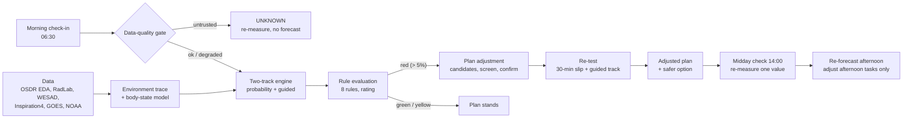

# How SpaceFuzz works

SpaceFuzz (NASA Space Apps 2026, Team Raccoon) does not display an astronaut's vital signs as they happen. Before the day starts, it stress-tests the day's task plan. A morning check-in (sleep, blood pressure, glucose, self-ratings, an optional reaction test) sets the starting state. A one-day body-state model then runs the plan thousands of times while six mutation operators perturb it: a harder EVA, a cabin CO2 build-up, an unplanned high-load task, a solar particle event, lost sleep, sensor faults. Each simulated day is checked against eight deterministic rules. The share of days that break a rule is the day's risk. If the risk is too high, SpaceFuzz searches for the smallest change to the plan that brings it down, and then re-tests the new plan before it is offered. Everything runs offline on a fixed random seed, so the same inputs always give the same result.

## Code map

| Path | Role |
|---|---|
| `spacefuzz/config.py` | Every threshold, mutation magnitude, sampling tier and the random seed (147) |
| `spacefuzz/readers/generic_reader.py` | Any CSV / TSV / XLSX table + YAML mapping → a standard format |
| `spacefuzz/readers/env_trace.py` | Builds one day of cabin air and radiation |
| `spacefuzz/readers/physio_replay.py` | WESAD chest ECG → minute heart rate / RMSSD fluctuation |
| `spacefuzz/core/plan_types.py`, `plan.py` | Plan format, validation, environment events |
| `spacefuzz/core/state.py` | Synthetic personal baseline, check-in loading |
| `spacefuzz/core/model.py` | 96-step day simulation and the causal chains |
| `spacefuzz/core/evaluator.py` | The eight rules and the fitness score |
| `spacefuzz/core/quality_gate.py` | Data-quality gate |
| `spacefuzz/fuzzing/mutator.py` | Mutation operators A-F and the causal-chain check |
| `spacefuzz/fuzzing/engine.py` | Two-track engine, heatmap, rating |
| `spacefuzz/fuzzing/adjuster.py` | Candidate plans, screening, re-test |
| `spacefuzz/fuzzing/midday.py` | Midday check |
| `spacefuzz/fuzzing/advice.py` | Act-now and prevent-today advice, measurement prompts |

Command-line forecast: `python -m spacefuzz.fuzzing.engine --plan data/plans/main_sleep_debt_eva.json --profile full`.

---

## 1. Data sources and processing

Real data is used to set three things: the environment curves, the size of real fluctuations, and parameter ranges. No public dataset gives one astronaut's continuous personal record, so the personal baseline, blood pressure and glucose are synthetic (see the end of this section).

All sources are converted to "minutes since the start of the clip" rather than aligned by calendar date. That is how 2014 ISS cabin air and 2017 radiation data can share one simulated day.

### Generic reader and YAML mappings

`spacefuzz/readers/generic_reader.py` reads any CSV, TSV or XLSX table. A mapping file in `data/mappings/` says which column holds time, which columns hold which fields, and in which units. The reader converts the table into one of three standard formats:

| Standard | Columns |
|---|---|
| env | timestamp, co2 [ppm], temp [degC], humidity [%], dose_rate [µGy/h] |
| wearable | subject, condition, segment_id, minute, hr [bpm], rmssd [ms] |
| clinical | long format: subject, timepoint, analyte, value, unit, reference range |

Unit conversions also live in the reader (for example 1 mGy/day = 41.67 µGy/h). To add a new data source, you add a block to a mapping file. No code changes are needed. `env_trace.py` and `physio_replay.py` read their own data through the same mappings.

### Datasets

Full links, file names and notes are in `data/SOURCES.md`.

| Dataset | Provider, licence | Used for | Processing notes |
|---|---|---|---|
| EDA RR-1 cabin telemetry (2014) | NASA OSDR, open data | Cabin CO2, temperature, humidity. The Mars-base scenarios use ISS cabin air as an analog | Only the `*_ISS` columns (`*_Ground` is the ground control chamber). Readings before 2014-09-27 13:30 (the switch time is inferred from the data) come from the launch pad and Dragon transit, not ISS cabin air, and are dropped. The quality gate's stuck-value check found this: CO2 sits frozen at 2,646 ppm for 153 h. Default day: 2014-10-15 |
| RadLab DosTel2, ISS Columbus (2017) | DLR instrument, via NASA RadLab; open data | ISS dose rate (primary ISS source) | Spikes roughly every 90 min are South Atlantic Anomaly (SAA) passes, not solar events. Sampling is denser during SAA passes, so the plain row mean (21.7 µGy/h) is biased high. The time-weighted mean is 8.8 µGy/h and the 15-min median is 4.94 µGy/h |
| RadLab MSL-RAD, Mars surface (2017) | NASA RadLab, open data | Mars dose rate; shape of the September 2017 solar particle event (SPE) | Baseline 7.79 µGy/h; event peak 2.98× baseline; 47 h above 1.25× baseline |
| EDA RR-1 radiation table (2014) | NASA OSDR, open data | Cross-check only | 0.202 mGy/day ≈ 8.42 µGy/h, consistent with the DosTel2 time-weighted mean |
| GOES-16 XRS-B, 1-min (2017) | NOAA NCEI, public domain | Flare timing labels only | Only rows with `xrsb_flag == 0`. The daily eclipse gaps stay empty and are not interpolated. The flares are quoted by their issued classes, X9.3 (09-06) and X8.2 (09-10). From the X8.2 flare peak to the SPE onset at Mars is about 12.9 h |
| NOAA solar proton event list (1976-2017) | NOAA, public domain | Daily SPE probability for operator D | 261 events in 15,341 days → 1.7% per day |
| WESAD, 4 subjects, chest ECG | University of Siegen; academic, non-commercial use | Stress effect on heart rate and HRV; real minute-to-minute fluctuation | See below |
| Inspiration4 CBC + CMP (OSD-569, OSD-575) | NASA OSDR, open data | Baseline ranges for glucose and hemoglobin; which indicators to watch | Too few people to set personal thresholds. One platelet value (C003, L-92) is a recording error and is excluded. Three R+45 samples show low glucose with high potassium, the signature of delayed sample processing, so they are excluded and not treated as a flight effect |

### WESAD processing

WESAD has no heart-rate column, so heart rate is derived from the 700 Hz chest ECG in a one-off offline step (`python -m spacefuzz.readers.physio_replay --build`):

1. Band-pass filter at 5-15 Hz, then detect R peaks (each peak must reach 40% of the local 2-second maximum).
2. Keep RR intervals between 40 and 180 bpm. Drop any RR interval that deviates more than 20% from the local median (ectopic beats, missed detections).
3. Compute one heart rate and one RMSSD value per 60-second window. Drop windows where clean RR intervals cover less than half the time.
4. Use labels 1 (baseline), 2 (stress), 3 (amusement) and 4 (meditation); drop 0 and 5-7. "Relax" is baseline plus meditation.

Results:
- **Stress effect** (subject fixed-effects regression): heart rate **+21.7 bpm** (95% CI 19.3-24.0), RMSSD **×0.512** (95% CI 0.476-0.551). These are the parameters of causal chain 1.
- **Fluctuation pool**: each minute's deviation from its segment mean. Heart-rate SD is 2.6 bpm when relaxed and 7.24 bpm under stress.
- Baseline ranges across subjects: heart rate 54.2-72.7 bpm, RMSSD 30.1-101.4 ms.

The WESAD licence allows academic, non-commercial use only. The repository therefore contains only the fitted parameters (`data/processed/wesad_params.json`), not the raw data or the per-minute series. You do not need to download anything to re-run the engine. Without the WESAD series, the engine generates the fluctuation from the fitted parameters with the same standard deviations, using an independent random stream so the other draws stay the same. Numbers can therefore differ slightly from the committed results. To reproduce them exactly, download WESAD (links in `data/SOURCES.md`) and run the build step above.

### What is synthetic

- **Personal baseline**: a 14-day synthetic history drawn with a fixed seed. Heart-rate and HRV centres come from the middle half of the WESAD ranges. Glucose comes from the middle half of the Inspiration4 pre-flight range (56-100 mg/dL). Sleep need 7.5 h, SpO2 98%, core temperature 36.8 °C, reaction time 270 ms and age 45 are illustrative values. Maximum heart rate = 220 − age = 175 bpm.
- **Blood pressure and glucose** check-in values are example data.
- **The crew member, Cmdr. L. Tan, is fictional.**
- **All thresholds and model parameters are illustrative**, not clinical limits.

---

## 2. Environment trace

`spacefuzz/readers/env_trace.py` builds one day of environment data as a table indexed by minute, in 15-minute steps, with columns `co2`, `temp`, `humidity` and `dose_rate`.

1. Each source is clipped from its own start time and expressed as minutes since that start.
2. Each source is resampled to 15-minute bins with time-weighted means, so densely sampled stretches (such as SAA passes) do not get extra weight.
3. Runs of up to two empty 15-minute bins are interpolated (`ENV_MAX_INTERP_STEPS = 2`, a gap of up to about an hour between samples). Longer gaps stay empty, and a day that still has gaps is refused.
4. The dose-rate source depends on the scenario: MSL-RAD for the Mars base, DosTel2 for the ISS.
5. Environment events from the plan are applied last. A `high_co2` event gives a `co2_ppm` value. The engine uses the larger of the event value and the replayed curve, because the event stands for a known equipment condition (for example running on the backup scrubber) and acts as a floor.

Reference values from the cabin analysis: the high-CO2 line is **3,997 ppm** (the 90th percentile of 15-minute cabin CO2). The highest reading recorded is 4,663 ppm. Cabin temperature is 22.1-22.9 °C and relative humidity 40-49% (5th-95th percentiles).

Plan items have a `kind`. A `task` is a crew activity, which the adjuster may move, shorten or drop. An `env` event is an environment condition, such as an SPE warning or high CO2. The crew cannot control an `env` event, so the adjuster never moves or shortens one; it can only move tasks around it.

---

## 3. Body-state model and the four causal chains

`spacefuzz/core/model.py` simulates a day as **96 steps of 15 minutes**, starting at the check-in (06:30 in the examples). At each step it reads three inputs: the current activity, the cabin environment, and any active environment events. Each plan task maps to one activity: EVA, treadmill, strength training, high-load work, ordinary work, idle, rest, meal or sleep. Every modelled quantity then moves part of the way toward a target value (a first-order response; time constants in `MODEL_TAU_MIN`).

Modelled quantities: heart rate, HRV (RMSSD), core temperature, SpO2, blood pressure, blood glucose, cognitive fatigue (0-100), reaction time, radiation load (a 0-100 strain index that recovers at rest), and the physical EVA dose and cumulative dose (µGy, which never decrease). Heart rate never exceeds the personal maximum of 175 bpm.

The chains are numbered as in the project plan, so the numbers are not consecutive.

| Chain | Cause → effect |
|---|---|
| 1 Acute stress | A high-load task (docking, precision manual work), an SPE warning or a dose-rate spike above 1.5× the trace median → stress level 0-1 → at full stress heart rate +21.7 bpm, RMSSD ×0.512 (both fitted on WESAD), blood pressure +12/+6 mmHg, glucose creeps up |
| 2 Energy and heat | EVA or exercise → heart rate up, HRV down, core temperature up, SpO2 slightly down. Heat stored during a hard EVA keeps warming the core. Above a +0.6 °C core rise (the NASA-STD-3001 V2 11011 heat-strain line), heart rate follows core temperature at +30 bpm per °C. Rest lets the heat and the heart rate come down. Cabin CO2 above 3,997 ppm adds heart rate, lowers SpO2 and speeds up fatigue (per 1,000 ppm of excess: +3 bpm, −0.8 SpO2 points, +2 fatigue points/h) |
| 5 Sleep debt | Debt = sum over the last 3 nights of max(0, need − slept). Each hour of debt raises resting heart rate (+0.8 bpm), lowers resting RMSSD (−3%), slows reaction time (+2.5%), speeds up fatigue (+4%), steepens the exertion heart-rate rise (+3%) and slows recovery (+8%). Sleep repays part of the debt |
| 6 Glucose | During exertion, glucose holds (small drift) while it is at or above 70 mg/dL. Below 70 it keeps falling and adds fatigue. Meals raise glucose; otherwise it returns to the check-in level |

**Real fluctuation.** The heart-rate and RMSSD outputs carry an added WESAD minute deviation, drawn from the stress pool when the stress level is above 0.5. The overlay is output only and never feeds back into the dynamics. The rules are judged on the overlaid values, because real sensor readings fluctuate and that fluctuation is part of the risk.

---

## 4. The six mutation operators

`spacefuzz/fuzzing/mutator.py` perturbs a copy of the day before each simulation. Magnitudes are drawn from the distributions in `config.py` (`OP_*`). The hazard column shows which of NASA's five hazards of human spaceflight an operator stands for; operators without one model workload or test the system itself. The full hazard mapping follows the table.

| Operator | What it simulates | Magnitude (source) | NASA hazard |
|---|---|---|---|
| A EVA physical load | The EVA stores heat faster (core-temperature target +0.1-0.3 °C per hour of continuous EVA), so heart rate climbs late in a long EVA. The EVA also runs 1-2 h longer or shorter. A longer EVA pushes later tasks back, and a pushed sleep keeps its end time, so it gets shorter | Illustrative; the ~140 bpm target follows NASA-STD-3001 V2 11011 | — (workload) |
| B Cabin CO2 build-up | The whole CO2 curve is scaled by (1 + e), with e drawn from the 34 observed daily peak excursions by their real frequency (mostly 11-23%, real tail to 40%). A science or maintenance task runs 1-4 h longer. SpO2 drops a further 2-5 points while CO2 is above the high line | Cabin analysis of EDA RR-1 | Hostile / closed environment |
| C Multi-task overload | A docking or precision manual task (0.5-1.5 h) is inserted in awake free time, never over an EVA or sleep. Fatigue jumps 20-40 points when it starts | Illustrative | — (workload) |
| D Solar particle event | The real MSL-RAD event shape is added to the dose rate from a random onset. The part above 1.25× baseline also gets an SPE warning event. Fatigue rises slowly while the event lasts | MSL-RAD event; NOAA event list | Radiation |
| E Isolation and sleep debt | Last night 0.5-3 h shorter. In half of these samples, all three nights are under 6 h. Reaction time slows accordingly and self-rated stress goes up by one | Illustrative | Isolation and confinement |
| F Sensor faults | Missing readings, signal dropout, stuck values, spikes, device offline. F changes only the wearable readings, never the body: it tests the system (the quality gate), not the crew | Illustrative | — (tests the data-quality gate) |

**NASA's five hazards** ([5 Hazards of Human Spaceflight](https://www.nasa.gov/hrp/hazards/)):

| NASA hazard | How SpaceFuzz covers it |
|---|---|
| Space radiation | Operator D (solar particle events shaped from real MSL-RAD data), rule 4 (no EVA during an SPE warning), the EVA radiation load |
| Isolation and confinement | Operator E (sleep debt), mood and stress self-ratings |
| Distance from Earth | The forecast runs locally on the base; the 20-minute delay is why the plan is fixed on site, and only cases that cannot be fixed go to the ground |
| Hostile / closed environments | Operator B (cabin CO2 from real ISS data), rule 3 |
| Gravity fields | Not modelled; the musculoskeletal and immune systems are marked as weekly checks |

NASA notes that these hazards do not stand alone and can make each other worse; SpaceFuzz stacks them on purpose to find where the body breaks first.

**Causal-chain check.** Every mutated sample is compared with the unmutated day. Each operator that was applied must move its own chain in the right direction, judged on the model's own columns and on aggregates such as peaks and totals. Samples that fail the check are discarded and counted. On the probability track the discard rate is 0%, because a sample usually carries zero or one operator. On the guided track, operators are stacked on seeds that are already mutated, and combinations push a chain the wrong way more often. In the current results the guided track discards 6.8% of its samples in the main scenario and none in the radiation and backup scenarios.

**Reproducibility.** A single numpy generator seeded with 147 drives every draw. The same inputs give bit-identical results.

---

## 5. Two-track engine

`spacefuzz/fuzzing/engine.py` runs two independent tracks. They never share samples, and each has its own mutator and random generator.

### Probability track (the only source of the risk number)

- 2,500 independent, unbiased samples. Each operator is switched on independently with the chance that it happens on a given day:

  | A | B | C | D | E | F |
  |---|---|---|---|---|---|
  | 20% (EVA days only) | 38.2% | 5% | 1.7% | 0% | 20% |

  Many samples therefore are an ordinary day with no operator at all. B's 38.2% is the share of observed cabin days whose CO2 peak exceeded the high line (13 of 34). E is 0% because last night's sleep is measured at the check-in and is not uncertain today. The "what if I had slept less" question is answered by the heatmap's sleep axis instead.
- **Risk = crashed samples / 2,500.** 2,500 is the smallest multiple of 500 whose 95% confidence interval separates the 1% and 5% lines (half-width 0.4 points at 1%, 1 point at 5%; checked on 5 seeds).
- **Time to crash**: the first time the cumulative crash share reaches 5%. It is given only when the risk is above 5%.
- Also reported: the most vulnerable system, the most common causal chain, and trajectory percentiles for the fan chart.

### Guided track (boundaries and crash types, no probability)

- A seed pool starts from the real day and keeps up to 200 seeds closest to a crash.
- Each round mutates the seed with the lowest fitness (80%) or a random seed (20%, exploration) by stacking 1-3 operators. A child that is closer to a crash joins the pool. A crash is recorded as a crash type (system + rule). A run of 300 rounds with no new type is logged as a plateau.
- It oversamples extreme combinations on purpose, so it is never used for probabilities. Its closest seeds are often far from a realistic day; the lowest seed on the main plan stacked 47 mutations. The track shows where the boundary is and which kinds of failure exist.
- On plans that are hard to break, the guided track finds crashes one to two orders of magnitude faster than random sampling, and finds crash types random sampling misses. On a plan that already breaks easily, random sampling is sometimes faster.

### Crash-boundary heatmap and smallest crashing change

- **Heatmap**: 7 rows (last night 0, 0.5, … 3 h shorter) × 5 columns (EVA 0, 0.5, … 2 h longer). Each cell is its own unbiased sampling run.
- **Smallest crashing change**: a deterministic scan of single changes in 15-minute steps, up to 3 h, finds the smallest one that crashes the plan. On the main plan it is **15 minutes less sleep**.

### Sampling tiers

Set the `FUZZ_PROFILE` environment variable to choose the tier; `local` is the default.

| Setting | local | full |
|---|---|---|
| Probability-track samples | 2,500 | 2,500 |
| Heatmap samples per cell | 300 | 2,500 |
| Guided-track rounds | 2,000 | 10,000 |
| Samples per adjustment candidate | 500 | 2,500 |
| Guided re-test rounds | 300 | 2,000 |

A full run of the main scenario is about 100,000 simulations, roughly 470 per second on a laptop. Most of the time goes into the heatmap.

### Rating

| Risk | Rating | Escalation |
|---|---|---|
| < 1% | LOW (green) | Self |
| 1%-5%, both ends included | MEDIUM (yellow) | Alert the crew |
| > 5% | HIGH (red) | Report to the ground flight surgeon |
| > 5% and time to crash ≤ 2 h | CRITICAL | Report to the ground |
| Data rejected by the gate | UNKNOWN (grey) | Re-measure only |

- **Out of model experience**: if a check-in value or the plan lies outside the ranges the model was built on (for example an EVA longer than 8 h), the rating is never green, is at least crew level, and comes with a coverage warning.
- The escalation is compared with the act-now advice from the check-in, and the more severe of the two is used.
- **Coverage warnings** list the rules and systems the guided track never reached.

---

## 6. The eight evaluation rules

`spacefuzz/core/evaluator.py` judges each simulated day. There are four composite rules, read from the model output, and four temporal rules. Each temporal rule is a small hand-written state machine that reads the day one 15-minute step at a time. All thresholds are illustrative. Sources are listed in `data/indicator_sources.md`.

| # | Rule | Condition | Threshold basis |
|---|---|---|---|
| C1 | Cardiovascular | Heart rate ≥ 0.8 × personal max (140 bpm at age 45) **and** RMSSD ≤ 0.5 × baseline, both held for 30 min; **or** blood pressure outside 90-140 / 60-90 mmHg after 60 min at rest | 140 bpm: NASA-STD-3001 V2 11011 (EVA impairment if pulse > 140 bpm). 0.5× RMSSD: WESAD stress effect ×0.51. 140/90: AHA/ACC high blood pressure guideline (stage 2) |
| C2 | Cognitive | Fatigue > 80 **and** SpO2 < 94% at the same step | NASA HRP risks: Sleep Loss, Circadian Desynchronization and Work Overload; Hypoxia (effects on cognition). The values are illustrative |
| C3 | Metabolic | Glucose < 70 mg/dL when an EVA starts, **or** an unbroken fall of 20 mg/dL during an EVA | ADA hypoglycemia level 1 (< 70 mg/dL) |
| C4 | Radiation dose | Day's EVA dose (all EVAs, both halves of a split EVA) > 150 µGy | About twice a 6.5 h Mars-surface EVA at the MSL-RAD baseline (7.79 × 1.5 shielding factor × 6.5 h ≈ 76 µGy). A daily load signal, **not a NASA limit**: NASA's formal radiation limits are career limits, a different quantity |
| T1 | Short sleep → EVA | After < 6 h of sleep, no EVA may start within 12 h of waking. A planned sleep of up to 2 h counts as a nap and does not restart the clock | Jones et al., *Sleep* 2022 (24 ISS astronauts): sleep < 6 h was associated with slower psychomotor response and higher stress |
| T2 | Training → EVA | No ARED strength or T2 treadmill training in the 2 h before an EVA starts | Illustrative operational spacing (NASA HRP EVA Operations risk) |
| T3 | High CO2 → precision work | After > 4 h of continuous cabin work at CO2 ≥ 3,997 ppm, no docking or precision manual work. EVA uses suit air, so it ends a run; so do rest and gaps | NASA HHP Carbon Dioxide risk; 3,997 ppm is the cabin CO2 90th percentile |
| T4 | SPE warning → EVA | No EVA may start during an SPE warning | NASA HRP radiation risk: shielding works against solar particle events |

**Steps to violation.** For each rule, the evaluator records the smallest change, in 15-minute steps, that would make it fire. Examples: 15 minutes less sleep or an EVA 15 minutes earlier (T1), training 15 minutes later (T2), 15 more minutes of high-CO2 work (T3), an EVA start moved by 15 minutes (T4). Zero means the rule is already violated.

**Fitness.** Each rule contributes a distance between 0 and 1, where 0 means violated. The fitness is the sum, and lower means closer to a crash. The guided track uses it to pick seeds.
- Temporal rules: min(steps, 16) / 16.
- Composite rules: the gap between the value and the threshold, divided by the gap between the personal baseline and the threshold, taken at the worst step of the day. An "and" rule needs every part, so it uses the largest part's gap.

**Determinism.** These safety checks are deterministic rules, not a language model. The same inputs and seed give the same result, offline. An optional, off-by-default interface hint can use a user-supplied OpenAI key to explain why a check-in was rejected; it never changes a decision or a number.

---

## 7. Data-quality gate

`spacefuzz/core/quality_gate.py` checks the inputs before the engine sees them. A forecast built on bad data can look normal, and that is the failure the gate exists to prevent.

**Wearable series** (heart rate, HRV, SpO2, core temperature) get three checks:

| Check | Rule | Effect |
|---|---|---|
| Out of range | Outside physiological plausibility (e.g. heart rate outside 25-250 bpm) | Reading removed |
| Stuck | Identical consecutive readings for too long: heart rate / HRV 60 min, core temperature 120 min, SpO2 180 min (integer SpO2 can plateau) | Whole field unusable |
| Missing | Field absent, or more than half of its readings empty or removed | Field unusable |

**Check-in values** read by the model and the rules are systolic and diastolic pressure, glucose, last night's sleep, the last three nights' sleep, fatigue, mood, stress and reaction time. If any of them is out of its plausible range or not entered, the result is **untrusted**, and the card names the item to re-measure (for example "Re-measure: sleep last night (20 outside 0-16)"). A sleep entry of 20 h would make the day look safe, so it is never simulated. The one exception is the reaction test: it is optional, and leaving it out only makes the result degraded.

| Result | Meaning |
|---|---|
| ok | Every field usable, nothing removed |
| degraded | Forecast as usual; the card lists what is missing |
| untrusted | Fewer than half the fields usable, every vital-sign series unusable, or a check-in value rejected. No forecast: the rating is UNKNOWN and only re-measure advice is given |

Cabin temperature and humidity are not checked for stuck values. Thermal control is tight and the sensor resolution is coarse, so on normal ISS days they stay unchanged for 6-8 hours.

---

## 8. Act-now and prevent-today advice

`spacefuzz/fuzzing/advice.py` turns the check-in into immediate advice, before and independent of the forecast. Each item carries its own escalation level. All trigger values are illustrative.

| Check-in finding | Advice | Escalation |
|---|---|---|
| Blood pressure outside 90-140 / 60-90 mmHg | Recheck; report to the ground if it stays outside | Ground if confirmed |
| Blood pressure ≥ 180 / 120 mmHg (severe hypertension, AHA/ACC 2025) | Recheck after 5 minutes; hold EVA and high-load tasks meanwhile | Ground if the recheck is still that high |
| Glucose < 70 mg/dL (ADA level-1 hypoglycemia) | Take 15 g of fast-acting carbs and recheck glucose in 15 minutes (ADA 15-15 rule) | Self |
| Glucose < 54 mg/dL (ADA level-2 hypoglycemia) | Take 15 g of fast-acting carbs now, have a crewmate stay, recheck in 15 minutes and notify the flight surgeon | Crew, with the ground notified |
| Sleep < 6 h last night, or a 3-night sleep debt ≥ 3 h | A nap before demanding tasks and an early night; once an adjusted plan exists, the advice points to the nap it schedules | Crew |
| Resting heart rate ≥ 10 bpm above baseline, mood ≤ 2 or stress ≥ 4 (1-5 scales) | Recheck or support | Crew |

**Prevent-today advice** comes from the forecast instead: each rule that crashed samples on the probability track yields one preventive line (for example, for the cardiovascular rule: drink water and take carbs before the EVA and keep the planned rest breaks). The forecast's escalation and the act-now escalation are compared, and the more severe one is shown.

---

## 9. Plan adjustment and re-test

`spacefuzz/fuzzing/adjuster.py` runs when the original plan is red (or when the check-in puts a task on hold).

### Candidates

- Move the EVA later by 30, 60 or 120 minutes.
- Start the EVA after an environment event it overlaps ends (for example an SPE warning).
- Shorten the EVA by 1 or 2 h (it keeps at least 60 minutes).
- Split the EVA into two halves with a 1 h rest between them.
- Insert a rest (30 or 60 min) or a nap (60 or 90 min) before the EVA.
- Move training to after the EVA.
- Postpone the EVA to another day.
- On days without an EVA: insert a rest before docking or precision work.

Up to two of these are combined. Three-change candidates come from a **beam search of width 5**: the five best two-change candidates, ranked by screened risk, each get one more change. The search is not exhaustive.

**Sleep is protected.** This applies to both the morning and the midday adjustment. When a change pushes later tasks back, personal time is shortened or cancelled first, and the change list says so (for example "Cancel personal time"). If planned sleep would still have to move or get shorter, the candidate is invalid. An adjustment must not create the sleep debt it is meant to fix. The fuzzer's own perturbations still squeeze sleep on purpose: an EVA overrun eating into the night is one of the what-ifs it tests.

**Size of change.** Every candidate has a cost: 1 per hour moved, 2 per hour removed by shortening, 1.5 for a split, 1 per hour of rest or nap, 1 for moving training, and 100 for postponing. Smaller changes are tried first, so postponing is chosen only when nothing smaller works.

### Screen → confirm → re-test

1. **Screen**: every candidate is sampled with the same random numbers (2,500 samples in the full tier), so differences between candidates come from the plan alone.
2. **Confirm**: candidates at or below 5% are taken in order of size. The first one is confirmed with a fresh full probability track.
3. **Re-test** ("patch, then test again"). A plan reported as fixed, meaning out of the red zone, must pass two checks:
   - **30-minute schedule-slip check**: the plan must survive a normal 30-minute slip of the schedule (training later, an EVA overrun, an EVA moved into an SPE warning, more high-CO2 work). In other words, its smallest crashing schedule change must be larger than 30 minutes.
   - **Guided-track re-test**: the guided track runs on the new plan and its crash types are reported.

   If a candidate fails, the next one is tried. If none works, the lowest-risk candidate is kept and the plan is reported to the ground. A fallback that still confirms below 5% counts as fixed and passes both checks. A fallback that stays red gets the guided-track re-test only. The slip check asks whether a fixed plan keeps a safety margin, and a red plan has none.

### Two options, always

When the plan has an EVA, two options are always given. If a same-day plan is chosen, postponing is added as the safer option. If postponing is chosen, the best same-day plan is added as "if the EVA must happen today". The crew and the flight surgeon decide. The risk after postponing covers **today only**; the EVA is forecast again at the next morning's check-in.

The escalation level comes from the original plan's rating: a red plan is adjusted first and then reported to the flight surgeon.

### Measure first

Each check-in value is shifted by its typical measurement error (for example sleep ±0.5 h, glucose ±15 mg/dL, blood pressure ±5 mmHg, reaction time ±20 ms) and the risk is recomputed. The value whose error moves the risk most is named first; only values that move it by at least 1 percentage point are listed. On the main plan, sleep (6.2 h) is only 0.2 h above the 6 h line, and a ±0.5 h error moves the risk by about 79 percentage points. The prompt is therefore to confirm last night's sleep with the wristband.

---

## 10. Midday check

`spacefuzz/fuzzing/midday.py` handles the midday check, at 14:00 in the example (during the rest between the two EVA halves). The crew re-measures the value the morning prompt named first. In the example this is wristband sleep, 5.9 h, against a self-reported 6.2 h.

- The **whole day is simulated again from the morning**, so the heat and fatigue left by the morning EVA are kept. Only violations from 14:00 onward count, because the question is "is the rest of today still safe?".
- Violations that already happened before 14:00 are listed separately as a record, not a forecast. With 5.9 h of sleep, the morning EVA broke rule T1; that is recorded and reported to the flight surgeon.
- Only afternoon tasks may change. All the morning candidates are reused with the morning EVA masked out, and two afternoon options are added: cancel the afternoon EVA, or start it once the rule-T1 window (12 h after waking) has passed. Sleep protection applies here too.
- Time to crash is counted from 14:00. With 5.9 h of sleep, the 14:15 afternoon EVA breaks rule T1 within 15 minutes, so the afternoon is CRITICAL.

---

## 11. Demo results and limitations

### Demo results (seed 147, full profile)

| Scenario | Before | After | Adjustment |
|---|---|---|---|
| Main: sleep debt + EVA (Mars base; last night 6.2 h, 3-night debt 6.9 h) | 21.0% HIGH | **4.9% MEDIUM** | EVA shortened by 2 h, a 1 h nap at 10:00, EVA split into 11:00-13:15 and 14:15-16:30 |
| Main, safer option | 21.0% HIGH | **0.1% LOW** (today only) | Postpone the EVA |
| Radiation: SPE warning 09:00-15:00, EVA planned at 10:00 | 100% | **3.0% MEDIUM** | 30-min rest, EVA starts at 15:30 |
| Backup: backup scrubber, CO2 floor 6,000 ppm, docking after long cabin work | 100% | **32.3% HIGH** | Still red; reported to the ground |
| Midday (14:00, wristband sleep 5.9 h) | Afternoon 100% CRITICAL | **4.9% MEDIUM** | Afternoon EVA starts at 18:00 (12 h after waking, rule T1); personal time cancelled; tonight's sleep stays at 23:00, 6 h |

Notes on the results:
- **Main scenario.** The closest crash on the original plan is **15 minutes less sleep**. The adjusted plan's re-test margin: training 1 h 15 min later turns it red.
- **Radiation scenario.** Starting the EVA at 15:00, right as the SPE warning ends, failed the re-test: a 15-minute slip lands the start inside the warning. The plan that starts at 15:30 after a 30-minute rest was chosen instead.
- **Backup scenario.** No candidate brings the plan out of red. It gets the guided-track re-test only and is reported to the ground.
- **Robustness** (re-run on the final code, 2026-11-15). Across 5 seeds (2,500 samples each), the main scenario's risk stays between 19.4% and 21.2%, red every time; a safe-day control plan stays between 0.7% and 1.2% and is never red. **Threshold sensitivity:** moving each of the 12 rule thresholds to 0.8-1.2× one at a time keeps the risk ranking of the five example plans stable (Kendall τ ≥ 0.8) in 92% of the 48 cases; the adjusted main plan is lower-risk than the original in 94% of them and never higher (median drop 16.2 percentage points).

### Limitations

- **Parameters are illustrative.** All thresholds and model parameters are illustrative, not clinical limits. Absolute probabilities depend on them. What the results support is the ranking of risks and the before/after change.
- **Synthetic inputs.** Blood pressure, glucose, the personal baseline and the 14-day history are synthetic. Cmdr. L. Tan is fictional. The Mars-base cabin air is ISS cabin data (NASA OSDR EDA, RR-1) used as an analog.
- **Gravity is not modelled.** Of NASA's five hazards, gravity fields are not covered.
- **No real astronaut data.** Real astronaut measurements are held in NASA's Life Sciences Data Archive (LSDA) and require a formal application, which can include an ethics review. SpaceFuzz uses public OSDR data, WESAD (ground laboratory data) and simulation instead.
- **Earth-orbit proxies for Mars.** The SPE daily probability and flare timing come from Earth-orbit data. Mars has no global magnetic field and sits at a different distance from the Sun, so real doses differ.
- **Adjustment search is not exhaustive.** Three-change candidates come from a beam search of width 5, so a better combination may exist.
- **Guided-track samples are not realistic days.** The guided track stacks extreme combinations on purpose. Its samples show boundaries and failure types, not likely days, and are never used for probabilities.
